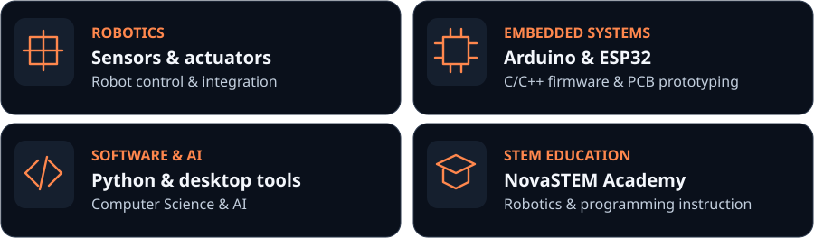

## About me

I’m a Computer Science & AI student at Pharos University in Alexandria. I build robotics and embedded systems, from electronics and firmware to the software people use to operate them. I founded **NovaSTEM Academy**, where I teach robotics and programming.

## Areas & skills

**[Explore my repositories →](https://github.com/moustafa-thabet1?tab=repositories)**
