  

  
  

I'm a third-year Computer Science student (AI major) focused on **embedded systems and AI**. I design hardware, write the firmware, and add intelligence on top: from a CAN and LIN diagnostics internship at **BMW** to a **processor I'm building from transistors up**.

Outside the lab I teach robotics and LEGO, coach competition teams, and judge national robotics events. I founded **NovaSTEM** so more students get to build real machines.

**Open to:** embedded and AI internships, research programs, scholarships, and junior roles.

**BMW internship (90 hours, 2 weeks):** worked with CAN, LIN and the other in-vehicle bus protocols and ECUs, ran diagnostics from the lab bench to the vehicle, and took part in a vehicle software update.

| Project | Code |
|---|---|
| MumGuard | _repo coming soon_ |
| Autonomous Fire-Fighting Boat | _repo coming soon_ |
| Afro-Asian ROV | _repo coming soon_ |
| Marine-facing Radar | _repo coming soon_ |
| NovaChip | _repo coming soon_ |

<b>More from the lab</b>

 

- Gas leak detector with automatic alert (Pharos Science Research Day 2025)
- AI surveillance camera with automatic alert (Pharos Science Research Day 2025)
- Contactless elevator add-on that picks your floor with no user interaction
- Smart lock whose password keeps changing
- Assistive navigation system for visually impaired guests at hotels and events
- Rover robot built with an agriculture-faculty team
- MedXR
- Driver X

**Teaching and founding**

- Founder of **NovaSTEM**, a STEM academy (working toward STEM.org educator accreditation)
- Robotics and LEGO instructor at Big Hero Academy
- Head Coach, Afro-Asian Scratch Competition 2025/2026: my students placed 3rd and 4th nationwide

**Judging** (each one certified)

| Event | Role |
|---|---|
| WRO Egypt 2026 | Judge, Future Engineering |
| IEEE SSCS Arduino Contest 2026 | Judge, Arduino projects |
| Robotiada Egypt 2026 | Judge, Sumo |
| Arab Robotics Championship 2026 (17th edition) | Volunteer, Sumo judging support |
| MRC Egypt 2026 | Accepted as Sumo judge, event on 18 Dec 2026 |

**Leadership**

- IEEE (2025–2026): Chair of the Robotics & Automation Society student chapter, Head of Technical Committees at IEEE Pharos Student Branch, Project Coordinator at IEEE SIGHT Group, Ambassador for IEEE YESIST12, Regional Representative for IEEE PES TGM 6.0
- Head of Technical Support, World Food Forum Egypt Chapter

If you're building something with sensors, motors, or silicon, I'd like to hear about it.

- LinkedIn: [linkedin.com/in/moustafa-thabet1](https://www.linkedin.com/in/moustafa-thabet1)
- Email: [moustafahosny@ieee.org](mailto:moustafahosny@ieee.org)

